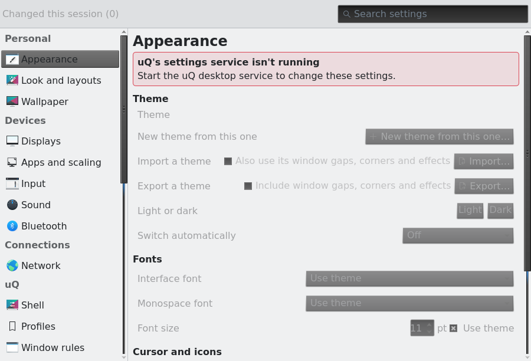
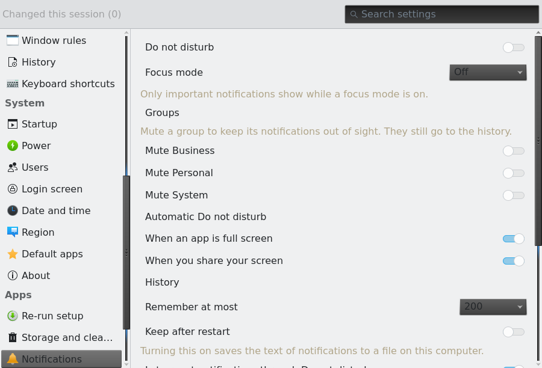

# Theming review: where uQ's theme isn't enforced

Reviewed on 2026-11-12 against main at b428670 (0.3.0-rc.2 plus fixes). This is a review only;
no code was changed. Line numbers are for that commit.

**How it was checked.** I read the theme pipeline (`themes/`, `templates/`, `crates/`) and the
QML in `shell/`, `lock/`, `greeter/` and `apps/uq-settings/`. I also inspected the live session on
the dev machine: Gruvbox dark is active, `uqctl setup --apps` has been run, and Kvantum is
installed. The installed Settings app (uq 0.3.0rc2-1.358) was rendered offscreen with
`uq-settings --screenshots` under `QT_QPA_PLATFORMTHEME=qt6ct`. Two of those shots are next to this
file:

| Appearance page, Gruvbox dark | noti-fi plugin page, Gruvbox dark |
|---|---|
|  |  |

The window is Breeze Light, the controls are dark Kvantum, the switches are Breeze blue rather
than the gold accent, and the plugin page's muted text is light Gruvbox text on a light window.
The screenshots were rendered offscreen with no uqd. Everything else marked *(verify live)* is
inferred from how the tool behaves and still needs checking in a real session.

## Status

The Settings fixes are done in the working tree (not committed yet): **F1, F4, F5, F15, F16, F21,
F22, F24**, plus the Settings side of F6 and F12. uqd renders `kde/uq.colors`, and Settings loads
it with the theme's icons and font, at start and on every `ThemeChanged`. One part is still open:
controls drawn by Kvantum keep their colours until Settings restarts. F23 is done for UqComboBox
(MenuItem rows with the template rows' inset); the RTL padding is left. Everything else is still
open.

## The short version

- **The shell is in good shape.** It has no QtQuick.Controls widgets, no hex colours and no
  literal fonts, and `scripts/lint-shell.sh` keeps it that way. Its problems are fixed geometry,
  emoji used as icons, icons that are never tinted, and a few contrast cases.
- **Settings doesn't look like uQ at all.** Kirigami takes its colours from KColorScheme, and with
  no `kdeglobals` that means Breeze Light. Kvantum then paints dark controls on top. The result is
  a light window with dark widgets, highlights in Breeze blue, and Qt's default font. This is the
  most visible problem in the review.
- **Theming other apps is opt-in and only partly done.** On a fresh install `uq-session` runs
  `uqctl setup --quiet` without `--apps`, so GTK, Qt and terminals get no uQ colours at all. With
  `--apps`, GTK 3 apps stay Adwaita Light, Qt apps don't get the theme's fonts, and running apps
  mostly don't follow a theme change.
- **Third-party apps:** noti-fi ignores uQ's tokens because of its own `rules.json` (already found
  in the VM run, N7). satty follows libadwaita (light/dark yes, colours only after a restart). kitty
  needs a restart to change colours. The greeter has no themed cursor or icons.

## Severity ranking

| # | Sev | Area | Finding |
|---|---|---|---|
| 1 | High | Settings / Qt | Kirigami colours are Breeze Light, not uQ (no kdeglobals) |
| 2 | High | Native | App theming is off on a fresh install (`--apps` is opt-in) |
| 3 | High | Native / GTK | GTK 3 apps stay Adwaita Light: no `gtk-theme`; colour-scheme does nothing for GTK 3 |
| 4 | High | Settings | Highlighted rows keep normal text colour (combos, sidebar, search, menus) |
| 5 | High | Settings | UqComboBox popup width doesn't match its rows (clipped / half-empty popups) |
| 6 | High | Runtime | Running Qt apps (Settings, Dolphin, tray menus) don't follow a theme change between same-icon themes |
| 7 | High | Shell | Symbolic icons are never tinted; a pinned icon theme gives light icons on a light bar |
| 8 | High | Greeter | Clock drawn straight on the wallpaper with no scrim |
| 9 | High | Shell | Window-pick hint: dark text on a dark scrim in light themes |
| 10 | High | Themes | Contrast check skips error/success/warning and muted-on-overlay (Gruvbox error on bg 2.69:1) |
| 11 | High | noti-fi | noti-fi's `rules.json` theme overrides uQ tokens, so it never follows uQ |
| 12 | Medium | Native / Qt | Qt apps never get uQ fonts (no `[Fonts]` in qt6ct.conf) |
| 13 | Medium | Native | No settings portal dependency: libadwaita, Firefox and Electron may not see dark/light |
| 14 | Medium | Native / Qt | Kvantum base ignores the variant: dark themes inherit light SVG bases |
| 15 | Medium | Settings | Wrong icon theme wins (breeze before Papirus) when qt6ct names none |
| 16 | Medium | Settings | Plugin pages get tokens once; `item.theme` is assigned, not bound |
| 17 | Medium | Shell | Tray and noti-fi menus are native QMenus, not uQ-styled |
| 18 | Medium | Shell | Emoji and Unicode glyphs used as icons |
| 19 | Medium | Shell | Fixed bar/row/cell sizes that don't scale with font size |
| 20 | Medium | Shell | PowerMenu "now" button: `accentText` on `warning` |
| 21 | Medium | Settings | DisplayArrangement mixes the Qt palette and Kirigami colours |
| 22 | Medium | Settings | ThemeChip current-theme label coloured with highlightColor on a highlighted button |
| 23 | Medium | Settings | Popup rows are ItemDelegates, not MenuItems; template items misaligned |
| 24 | Medium | Settings | No fallback when qqc2-desktop-style is missing (wrong error message) |
| 25 | Medium | Terminals / GTK | Running terminals and GTK apps keep old colours after a theme change |
| 26 | Medium | Templates | Settings-page template uses pixel literals and a `"red"` fallback |
| 27 | Medium | Shell | Icon names that exist only in Papirus or breeze |
| 28 | Low | Greeter | No cursor theme, no icon theme, no selection colours |
| 29 | Low | Hyprland | Group/groupbar colours and the shadow colour aren't themed |
| 30 | Low | satty, slurp | Annotation font/palette and slurp's selection colours not from the theme |
| 31 | Low | Shell | `Theme.radius - 2` and `fontSize - 1` can go negative or tiny |
| 32 | Low | Shell / Settings | Literal spacing, border widths, monospace family, secondary-text convention |
| 33 | Low | Templates | qt6ct BrightText/Shadow hard-coded; GTK 4 uses only legacy `@define-color` |
| 34 | Low | Web tokens | `fonts.size` (points) emitted as px |

---

## 1. Native theming pipeline

What exists today: uqd renders `templates/*.j2` into `~/.local/state/uq/theme/`
(`crates/uq-core/src/render.rs:31-39`). It sets six gsettings keys (`crates/uqd/src/system.rs:32-50`),
sets the Hyprland cursor, keeps `icon_theme=` in a uQ-written qt6ct.conf
(`crates/uq-core/src/qt6ct.rs`), and restarts uq-shell when `shell.env` changes
(`crates/uqd/src/service.rs:1251`). Apps get the files only through the "consumer" stubs written by
`uqctl setup --apps` (`crates/uq-core/src/stub.rs:76-115`).

### F2 (High): app theming is off on a fresh install
- **Where:** `packaging/uq-session:31` runs `uqctl setup --quiet`, without `--apps`.
  `crates/uqctl/src/setup.rs:152-157` only prints "Run `uqctl setup --apps` to opt in". The README
  mentions it at `README.md:42,132`.
- **What is wrong:** none of the GTK css, qt6ct.conf, Kvantum or terminal stubs exist until the user
  finds that command. The `qt6ct.rs` icon sync and the Settings "Style Qt apps to match the theme"
  switch (`AppearancePage.qml:661`) only act on files that `--apps` wrote. Without them the switch
  does nothing visible.
- **How it shows:** after a fresh install, every Qt app (Settings included) is Fusion with the
  default light palette and every GTK 3 app is Adwaita Light. Only the shell, the Hyprland borders
  and libadwaita's dark/light follow the theme.
- **Fix:** offer it in the Welcome flow as a clearly worded step ("Make apps match uQ. This also
  changes how they look in other desktops"), defaulting to on. Also give the Appearance page a
  switch with the same effect, which calls the same code through uqd. Keep `install_consumers`'
  never-overwrite rule, and say in the UI which files were left alone.

### F3 (High): GTK 3 apps stay Adwaita Light
- **Where:** `crates/uqd/src/system.rs:37-46` sets `color-scheme` but never `gtk-theme`.
  `templates/gtk3.css.j2:3-13` only redefines Adwaita's public named colours. Live gsettings show
  `gtk-theme='Adwaita'`, and no `~/.config/gtk-3.0/settings.ini` exists.
- **What is wrong:** GTK 3's Adwaita ignores `color-scheme` and draws its widgets with colours fixed
  when its stylesheet was compiled. Redefining `theme_bg_color` and the other named colours changes
  only the few apps that use them.
- **How it shows:** in every dark uQ theme, GTK 3 apps (pavucontrol, GIMP, Firefox dialogs,
  file choosers through portal-gtk) are light Adwaita with odd patches of uQ colour.
- **Fix:** depend on (or optdepend and detect) `adw-gtk-theme`, and set `gtk-theme` to `adw-gtk3`
  or `adw-gtk3-dark` from the variant in `gsettings_commands`. adw-gtk3 is built on libadwaita's
  named colours, so `gtk3.css.j2` should define the libadwaita names (`window_bg_color`,
  `view_bg_color`, `accent_bg_color` and the rest, as `gtk4.css.j2` does). Also write
  `gtk-3.0/settings.ini` with `gtk-application-prefer-dark-theme` for setups that don't read
  gsettings.

### F12 (Medium): Qt apps never get uQ's fonts
- **Where:** `crates/uq-core/src/stub.rs:92` writes `[Appearance]` only. The theme's fonts go to
  gsettings only (`system.rs:42-45`).
- **How it shows:** Settings, Dolphin, Kate and the tray menus render in DejaVu LGC Sans 12
  (measured), while the shell and GTK use Inter 11. Choosing a font on the Appearance page doesn't
  change any Qt app.
- **Fix:** keep `[Fonts] general=` and `fixed=` in step in `qt6ct.rs`, in the same place as
  `icon_theme`. qt6ct stores them as QFont strings, e.g. `"Inter,11,-1,5,400,0,0,0,0,0,0,0,0,0,0,1"`.

### F6 (High): running Qt apps don't follow a theme change
- **Where:** `service.rs:1242` touches qt6ct.conf only through `sync_icon_theme`, which writes only
  when the icon theme differs. qt6ct's platform theme reloads on changes in its own config directory,
  not on changes to `color_scheme_path`'s target. Kvantum reads its kvconfig once. Nothing in
  Settings reacts to ThemeChanged.
- **How it shows:** switching Gruvbox dark → Dracula dark (same Papirus-Dark icons) leaves Settings,
  Dolphin and the shell's tray menus on Gruvbox colours until they restart. Dark ↔ light works for
  the qt6ct palette only, because the icon theme changes too. *(verify live)*
- **Fix:** on every theme apply, rewrite qt6ct.conf whenever it is uQ's file, for example with a
  `# uq-theme=<id>-<variant>` line so the content always changes. That makes qt6ct reload its
  palette, icons and fonts. Kvantum apps still need a restart: Settings should re-apply its palette
  itself (see F1) or show "Reopen to finish applying".

### F13 (Medium): no settings portal is guaranteed
- **Where:** `packaging/uq/PKGBUILD:14-16` has no `xdg-desktop-portal-gtk` (or `-gnome`).
  xdg-desktop-portal-hyprland doesn't implement `org.freedesktop.appearance`. On this machine
  portal-gtk is installed and `hyprland-portals.conf` falls back to it, but that is luck.
- **How it shows:** libadwaita apps (satty), Firefox, Chromium and Electron apps read
  `color-scheme` through the Settings portal. Without portal-gtk they stay light in dark themes and
  don't switch with the schedule.
- **Fix:** depend on `xdg-desktop-portal-gtk`, and ship `/usr/share/xdg-desktop-portal/uq-portals.conf`
  with `default=hyprland;gtk` (and `org.freedesktop.impl.portal.Settings=gtk`), keyed on the
  session's `XDG_CURRENT_DESKTOP`.

### F14 (Medium): dark variants inherit light Kvantum bases
- **Where:** `crates/uq-core/src/render.rs:51,76-80` picks the first of KvGnome, KvAdapta, KvArc and
  KvFlat whatever the variant. `templates/kvantum.kvconfig.j2:3` inherits it. Dark siblings
  (KvAdaptaDark, KvArcDark) are installed here.
- **How it shows:** the SVG parts that Kvantum doesn't recolour from `[GeneralColors]` (frames, tab
  and button bevels, focus rings) keep the light base's look in dark themes. *(verify live)*
- **Fix:** keep a per-variant list (`KvArcDark` for dark, `KvArc` for light, and so on) and pass
  `is_dark` into the choice.

### F33 (Low): template hygiene
- `templates/qt6ct.conf.j2:3` hard-codes BrightText `#ffffffff` and Shadow `#ff000000`. Derive
  BrightText from `accent_text` (or from `bg` in light themes).
- `templates/gtk4.css.j2` uses only `@define-color`. libadwaita 1.6+ prefers CSS variables
  (`:root { --window-bg-color: … }`), and `@define-color` support is a compatibility path. Emit both.
- `gtk4.css.j2` doesn't define `shade_color`, `scrollbar_outline_color`, `thumbnail_*` or the
  `*_backdrop` colours. Those are minor gaps in sidebars and file choosers.

### Cursor
`crates/uq-core/src/lua/mod.rs:212-223` emits `XCURSOR_THEME`/`XCURSOR_SIZE`, and uqd runs
`setcursor` live. That is fine for the session. `config/hypr/base.lua:53-54` still hard-codes
`XCURSOR_SIZE`/`HYPRCURSOR_SIZE` 24 before `generated.lua` overrides them. This is harmless, but it
is a second source of truth. See F28 for the greeter.

---

## 2. Settings app (`apps/uq-settings/`)

### F1 (High): Kirigami colours are Breeze Light, not uQ
- **Where:** `apps/uq-settings/src/main.rs:149-152` forces `org.kde.desktop`. With that style
  Kirigami colours come from KColorScheme, which reads `kdeglobals`. uQ never writes one (none
  exists on this machine) and never sets `KDE_COLOR_SCHEME_PATH`.
- **Measured** on Gruvbox dark: `palette.window` #282828 and `palette.highlight` #d79921 (uQ), but
  `Kirigami.Theme.backgroundColor` #eff0f1, `textColor` #232629 and `highlightColor` #3daee9
  (Breeze Light).
- **How it shows:** see the screenshots. The window is light grey, combos and buttons are dark
  Kvantum, switches and selection are Breeze blue, and the selected sidebar row is dark text on a
  dark Kvantum selection. Every `Kirigami.Theme.*` use is the wrong colour (ThemeChip, SettingRow
  flash, banners, ErrorCard, RuleMessage, UqAvatar, LayoutsStep). Dolphin and Kate have the same
  problem wherever KColorScheme is used.
- **Fix:** have uqd render a KDE colour scheme, `templates/kdecolors.j2` →
  `theme/kde/uq.colors` (`[Colors:Window]`, `[Colors:View]`, `[Colors:Button]`,
  `[Colors:Selection]`, `[Colors:Tooltip]`, `[Colors:Complementary]`, `[Colors:Header]` mapped
  from the tokens). Then either set `qApp->setProperty("KDE_COLOR_SCHEME_PATH", …)` in
  `cpp/window.cpp` before `engine.load` (Settings only), or keep `ColorScheme=`/the colour groups
  in a uQ-owned `~/.config/kdeglobals` as part of `--apps` (all KDE apps). The second is better
  for Dolphin. Re-apply on ThemeChanged. *(The KDE_COLOR_SCHEME_PATH route was confirmed to exist
  in KF6ColorScheme but not yet tried.)*

### F4 (High): highlighted rows keep normal text colour
- **Where:** a custom `contentItem: UqLabel` inside a delegate never switches to
  `highlightedTextColor`: `components/UqComboBox.qml:43-46`, `Sidebar.qml:85-98`,
  `Search.qml:94-107`, `components/AddStartupDialog.qml:88-103`, `pages/RulesPage.qml:555-560`.
- **How it shows:** once F1 makes highlights uQ's accent, light text sits on a light accent in
  dark themes (Graphite: #e4e4e7 on #8ab4f8), and dark text on a dark accent in light themes. Today
  it is the dark-on-dark sidebar row in the screenshot.
- **Fix:** give UqLabel a `highlighted` property that switches `color` to
  `Kirigami.Theme.highlightedTextColor`, and bind it to the delegate's `highlighted` everywhere.
  Add a lint rule: a delegate `contentItem` must pass `highlighted`.

### F5 (High): UqComboBox popup width doesn't match its rows
- **Where:** `components/UqComboBox.qml:41` sets `width: combo.width` on the delegate, but the KDE
  style's popup is a Menu sized to its widest item. `Layout.maximumWidth` (`:19`) only caps the
  box inside a Layout.
- **Measured:** an On/Off box 105 px wide got a 44.6 px popup with 105 px rows (clipped). A box
  with one long choice was capped at 360 px but its popup was 766 px wide, with 360 px rows, so the
  rows fill half the popup and the long choice is cut.
- **Fix:** `width: ListView.view ? ListView.view.width : combo.width` on the delegate, and
  `popup.width: Math.max(combo.width, <content width>)` capped at the window. Or override `popup`
  with a themed `QQC2.Popup` whose width is under our control.

### F23 (Medium): popup rows are list rows, not menu rows
- `UqComboBox.qml:38` uses `QQC2.ItemDelegate` inside the style's Menu popup, so rows get list-row
  padding and hover instead of menu-item padding and hover. Use `QQC2.MenuItem` as the KDE style's
  own ComboBox does, which also fixes the hover colour.
- `pages/RulesPage.qml:557-558` hard-codes `leftPadding`/`rightPadding: largeSpacing` on template
  menu items, so they don't line up with the style-drawn "Blank rule" item above.
- `UqComboBox.qml:36` pads the right side for an indicator that the KDE style makes an empty Item,
  and isn't mirrored for RTL. Use `LayoutMirroring`-aware padding and
  `horizontalAlignment: Text.AlignLeft`.
- **Inventory:** every dropdown goes through UqComboBox or OverrideCombo, and there is no plain
  `QQC2.ComboBox` anywhere. Callers that set widths use Kirigami units (DisplayRoles, DisplaysPage,
  DateTimePage, WallpaperPage, WorkspacePlanner, AppFixDialog, ShortcutEditor, GestureEditor,
  KeyboardLayoutList, NetworkPage). So fixing UqComboBox fixes every dropdown.

### F15 (Medium): the wrong icon theme can win
- **Where:** `cpp/window.cpp:37-48` tries breeze, breeze-dark, Papirus, Adwaita in that order when
  Qt has no icon theme. The live qt6ct.conf has no `icon_theme`.
- **How it shows:** Settings shows breeze icons while every uQ theme names Papirus-Dark or
  Papirus-Light. With F7's fix it also stops matching the bar.
- **Fix:** read `icons.theme` from `tokens.json` first, then fall back to that list.

### F16 (Medium): plugin pages get stale tokens
- **Where:** `src/app.rs:39,113` reads `tokens.json` once. `PluginPage.qml:43` sets
  `item.theme = page.theme` (an assignment, not a binding).
- **How it shows:** noti-fi, scdr, crumBS and the other pages keep the old theme's colours after a
  switch. They also paint dark-theme `textMuted` on F1's light window (second screenshot).
- **Fix:** re-read on ThemeChanged, and use `Qt.binding(() => page.theme)`.

### F21, F22 (Medium)
- `components/DisplayArrangement.qml:46-48` fills the boxes with `palette.*` (uQ), but the label at
  `:52` uses Kirigami colours (Breeze), so it is dark text on a dark box. It also has pixel literals
  (`:20` 16, `:28` 220, `:45` radius 4, `:43-44,54` 8). Use Kirigami.Theme and Units throughout.
- `components/ThemeChip.qml:45` colours the current theme's name with `highlightColor` on a button
  that is `checked` and `highlighted` (`:36-37`), so the text vanishes if the style fills it with
  the accent. `welcome/LookStep.qml:62-92` does the same job without the colour. Drop the colour
  override, or use `highlightedTextColor`.

### F24 (Medium): no fallback for a missing style
- `src/main.rs:151` forces `org.kde.desktop`. If qqc2-desktop-style is missing, the app exits with
  "is Kirigami installed?" (`main.rs:160`), which names the wrong package. It is a hard dependency,
  so this hits dev builds and broken installs only. Check the module exists, else use Fusion (which
  does follow the qt6ct palette) and log why.

### F32, Settings part (Low)
- Pixel literals: `CommandConfirmDialog.qml:47` and `RevertDialog.qml:30` (width 420);
  `CommandConfirmDialog.qml:53` (12), `WelcomeNav.qml:22` (8), `ProfileKeyList.qml:18`,
  `KeyboardLayoutList.qml:43` (4), `welcome/AppsStep.qml:67` (2), `OverrideSlider.qml:49` (36),
  `welcome/LayoutsStep.qml:78,88` (radius 3/2).
- `border.width: 1`: `ErrorCard.qml:17`, `RuleMessage.qml:63`, `ProfileMessage.qml:33`,
  `AppearancePage.qml:478`, `ThemeEditor.qml:251,291`, `WallpaperEntryEditor.qml:235`.
- `font.family: "monospace"` ignores the theme's mono font: `AdvancedDetails.qml:72,80,104,113`,
  `AutostartRow.qml:81,176`, `ThemeEditor.qml:266`. Use `Kirigami.Theme.fixedWidthFont`.
- Secondary text uses two conventions: about 131 `opacity: 0.7/0.8` against
  `color: Kirigami.Theme.disabledTextColor` in `welcome/HelloStep.qml:46`, `AppsStep.qml:79,104`,
  `DoneStep.qml:38` and `WallpaperPage.qml:121`. Add `UqLabel.secondary`.
- `negativeTextColor` (always #da4453) is used instead of the theme's `error`: ErrorCard,
  RuleMessage, `ThemeChip.qml:65`, `FingerprintStep.qml:54`. This goes away with F1.
- **Fine as they are:** ThemeEditor's preview (deliberately paints another theme), the derived
  `Qt.rgba(highlightColor…)` tints, UqAvatar, OriginLabel, KeyCapture, WorkspacePlanner.

---

## 3. Shell, lock and greeter

The shell has no QtQuick.Controls widgets except the MonthGrid/DayOfWeekRow in
`bar/TimeIsland.qml:154,164`, whose delegates are UqText. It has no hex colours outside the
defaults, no literal font families or pixel sizes, and plain `Text` only inside UqText, UqInput and
the allow-listed `NotifBody.qml:17`. Every Theme use is a live binding. All its own popups (tray
tooltip, calendar, Pin menu, window menu, widget popups, app actions, greeter pickers) use
surface, border, radius and UqText.

### F7 (High): symbolic icons are never tinted
- **Where:** icons come from `Quickshell.iconPath(name, true)` into `IconImage`, with no
  `MultiEffect`/colourization anywhere. `crates/uq-core/src/theme.rs:235` lets
  `appearance.icon_theme` override the theme's icons for both variants.
- **How it shows:** with "Papirus-Dark" pinned on the Appearance page, light mode shows light grey
  icons on a light bar. Adwaita symbolic icons are dark on a dark bar. Tinted themes (Dracula,
  Gruvbox) get neutral grey icons that don't match their text.
- **Fix:** a `UqIcon` component that tints `-symbolic` icons with
  `MultiEffect { colorization: 1; colorizationColor: Theme.text }` (or `accentText` when on).
  Separately, let the icon override name a family ("Papirus") so that uqd picks `-Dark`/`-Light`
  from the variant.

### F9 (High in light themes): window-pick hint unreadable
- `shell/pick/PickOverlay.qml:77` scrim `Qt.rgba(0,0,0,0.35)` with the hint at `:83-89` in
  `Theme.text`. In light themes that is dark text on a darkened screen. Put the hint on a
  `Theme.surface` card with border and radius.

### F8 (High): greeter clock on the bare wallpaper
- `greeter/Greeter.qml:114` and `greeter/shell.qml:282` place `auth/Clock.qml` (Theme.text and
  textMuted, `:14-25`) directly on the wallpaper, with no card, scrim or shadow. It is unreadable on
  a bright wallpaper with a dark theme, or the reverse. Add a `Theme.bg` scrim at about 40%, or a
  `MultiEffect` shadow.

### F10 (High): the contrast check misses most pairs the UI uses
- `crates/uq-core/src/contrast.rs:50-58` checks only text and text_muted on bg/surface(/surface_alt)
  and accent_text on accent.
- Not checked:
  - `error`, `success` and `warning` as text on bg/surface. Gruvbox dark error #cc241d on #282828
    is 2.69:1. It is used for the wrong-password message (`auth/MessageView.qml:21`), polkit errors
    and Spotlight errors.
  - `text_muted` on `overlay`, which is 3.5 to 4.1:1 in every theme and shows on hovered rows.
  - `accent_text` on `warning` (F20).
- **Fix:** add these pairs, use 3:1 for icon-only uses, and adjust the shipped themes that fail.
  Also add `*_text` tokens (`warning_text`, `error_text`) so that filled status chips don't borrow
  `accent_text`.

### F20 (Medium): PowerMenu "now" button
- `shell/power/PowerMenu.qml:264,280` puts `Theme.accentText` on `Theme.warning`: 3.33:1 in
  Gruvbox light. Use a `warning_text` token (F10), or `Theme.bg`.

### F17 (Medium): tray and noti-fi menus aren't uQ-styled
- `shell/bar/StatusIsland.qml:310` and `bar/NotifIsland.qml:129` use `QsMenuAnchor`, which opens a
  native QMenu styled by qt6ct and Kvantum. That means a different font (F12), a different radius
  and border, and stale colours after a theme change (F6). If `--apps` was never run it is plain
  Fusion light (F2).
- **Fix:** render menus with `QsMenuOpener` in a themed PopupWindow, as `WorkIsland.qml:329`
  already does for the window menu.

### F18 (Medium): emoji and glyphs as icons
- Colour emoji ignore `color:` and clash with symbolic icons, and they show as tofu without an
  emoji font. They are at `NotifIsland.qml:108,118`, `quick/AudioGroup.qml:211,332`,
  `ThemeGroup.qml:176,187`, `NetworkGroup.qml:99,149`, `PowerGroup.qml:127,135`,
  `BluetoothGroup.qml:89`, `notif/builtin/Centre.qml:186`, `power/PowerMenu.qml:35`,
  `launcher/AppMenu.qml:470`.
- Glyphs not in Inter fall back to another font: `⏻ ⏾ ↻ ⇥` (`PowerMenu.qml:36-39`,
  `AppMenu.qml:471-474`), `ᛒ` (`BluetoothGroup.qml:27`), `⚙` (`StatusIsland.qml:470`),
  `☰` (`SystemIsland.qml:187`), `☀` (`AudioGroup.qml:362`).
- **Fix:** symbolic theme icons through the UqIcon from F7. Extend `lint-shell.sh` to reject
  non-ASCII glyphs in `text:` used as icons.

### F19 (Medium): fixed geometry that doesn't follow font size
- Bar height 36 is repeated in `bar/Bar.qml:14`, `bar/Island.qml:13`, and as
  `Theme.gapOut + 36` in `AppMenu.qml:37`, `notif/builtin/Popups.qml:18`,
  `quick/QuickSettings.qml:25` and `notif/builtin/Centre.qml:28`.
- Cells are 26/28 in `StatusIsland:25`, `TimeIsland:17`, `WorkIsland:21`, `SystemIsland:17`,
  `widgets/Slot.qml:17` and `WidgetHost.qml:16`. There are about 39 literal row heights of 28/32/36
  (e.g. `AppActionMenu.qml:85`, `greeter/Button.qml:13`, `SessionPicker.qml:23`), and icon sizes
  are 18 to 24.
- **How it shows:** at font size 16 or more, text clips in the bar and rows.
- **Fix:** derived tokens in Theme.qml (`barHeight`, `rowHeight`, `iconSize`, computed from
  `fontSize`), and one `Bar.islandHeight` reference instead of the repeated 36.

### F27 (Medium): icon names outside Papirus
- These names are blank under Adwaita and other non-Papirus themes:
  - `display-brightness` (`logic/quick.js:170`)
  - `microphone-sensitivity-*` (`:168`)
  - non-symbolic `audio-volume-*` (`:166`)
  - `system-search` (`logic/launcher.js:7`)
  - `weather-showers-scattered` and `weather-few-clouds-night` (`logic/weather.js:17,11`)
- Papirus is only an optdepend. Use `-symbolic` names with fallbacks, or make papirus-icon-theme a
  dependency.

### F28 (Low): greeter cursor, icons, selection
- `packaging/uq-greeter-session` and `greeter/hyprland.lua` set no `XCURSOR_THEME` or
  `QS_ICON_THEME`, so the login screen has the default X cursor and Qt's default icon lookup.
- `shell/core/UqInput.qml:26-49` sets no `selectionColor`/`selectedTextColor`, so the greeter
  (no qt6ct) selects in Qt's default blue.
- The greeter applies tokens once and its variant is fixed in `/etc/uq/greeter.toml`. That is by
  design and acceptable.
- **Fix:** export the theme's cursor and icon theme in the greeter session, and set the selection
  colours to `Theme.accent`/`accentText` in UqInput.

### F31, F32, shell part (Low)
- `Theme.radius - 2` (about 40 sites) and `- 4` (`NotifCard:66`, `Centre:167,207`) go negative
  when a theme sets radius 0 to 3, which `tokens.js:52` allows. Add a `radiusInner` token, or
  `Math.max(0, …)`.
- `Theme.fontSize - 1` has no floor in `Spotlight.qml:383,433,442,494` and `AppMenu.qml:415`.
- Literal `spacing: 2/3/4` and `margins: 4` appear in SystemIsland, NotifIsland, TimeIsland,
  StatusIsland, AppMenu, Spotlight, NotifBody and WorkIsland.
- `border.width: 1` focus rings (23 sites, e.g. `PowerMenu.qml:206,266,295`,
  `quick/AudioGroup.qml:144`, `greeter/Button.qml:17`) instead of `Theme.borderWidth`.
- The hover tint is `Theme.overlay` in `AppActionMenu.qml:87` and `WidgetHost.qml:121`, but
  `surfaceAlt` elsewhere. Pick one.
- The Pin menu (`SystemIsland.qml:288-313`) has no hover or focus state. Today in the calendar
  (`TimeIsland.qml:174`) is bold only, with no accent.
- `idle/Dim.qml:41` and `wallpaper/Crossfade.qml:12` use black on purpose. That is fine.

---

## 4. Third-party apps

| App | How it is styled now | Follows uQ? |
|---|---|---|
| **noti-fi** (notification backend) | Its own Quickshell/Kirigami QML. It reads `tokens.json` ("auto"), but the `rules.json` written by `notify takeover` has an explicit `theme`, which wins (VM run N7, `docs/notes/vm-live-check-results.md:284-298`) | **No** (F11) |
| **satty** (Print) | GTK 4 + libadwaita, so `gtk-4.0/gtk.css` colours and portal `color-scheme` | Dark/light yes (needs portal-gtk, F13). New colours only on next launch, which is fine for a short-lived tool. Annotation font and palette are satty's defaults (F30) |
| **slurp** (fallback area picker) | slurp's built-in colours | No (F30) |
| **kitty** (SUPER+Return, `base.lua:10`) | `include …/terminal/kitty.conf` from `--apps` | Colours yes, after `--apps`. Running windows keep the old colours (F25). The font isn't set from `fonts.mono` |
| **foot / alacritty** | `include` / `import` stubs | Same as kitty. Alacritty may live-reload imports, but the theme dir is swapped atomically, so the watch can go stale *(verify)* |
| **Dolphin** (file manager), **Kate** | Qt Widgets via qt6ct + Kvantum | Palette and icons yes (after `--apps`). KColorScheme parts are Breeze Light (F1), fonts no (F12), live switch no (F6) |
| **Portals** | xdg-desktop-portal-hyprland, plus portal-gtk if installed | File choosers come from portal-gtk = GTK 3 (F3). The settings portal isn't guaranteed (F13) |
| **Greeter** | uQ QML with pre-rendered tokens per theme | Colours yes. Cursor and icons no (F28). Clock contrast (F8) |
| **hyprlock** (recovery bind only) | Its own defaults | No. It is a fallback, so low priority |
| **Hyprland** | `generated.lua`: borders, rounding, gaps, cursor | Mostly. See F29 |

### F11 (High): noti-fi never shows uQ's colours
- The cause is upstream: the `theme` block in noti-fi's takeover `rules.json` overrides its own
  tokens.json reading. uQ should ask noti-fi to have `notify takeover` stop writing an explicit
  `theme` (or write `"theme": "auto"`). Until then, uQ's Welcome step could remove that block when
  it installs noti-fi. It shows as noti-fi popups and lists that stay dark in light themes.
  noti-fi's own Settings page inside uQ also inherits F1 and F16.

### F25 (Medium): running terminals and GTK apps keep old colours
- uqd sends nothing to running apps. kitty supports `SIGUSR1` (reload config) and automatic
  `light-theme.auto.conf`/`dark-theme.auto.conf`, and foot supports `SIGUSR1`/`SIGUSR2` to switch
  between `[colors]` and `[colors2]`.
- **Fix:** after a render, signal running kitty and foot processes the user owns (`pkill -USR1 -x
  kitty`). Or render kitty's auto light/dark files and foot's `[colors2]` (other variant) so the
  terminals switch themselves on dark/light. GTK: libadwaita picks up dark/light live from the
  portal, but not the new accent and surface colours.

### F30 (Low): satty and slurp
- `packaging/uq-screenshot:76-79` passes no colours. Render `~/.config/satty/config.toml`
  (`[font] family = fonts.ui`, `[color-palette] palette = [accent, error, success, warning, text]`)
  as another `--apps` consumer. Pass `-b`, `-c`, `-s` and `-B` to slurp, built from the tokens in
  `tokens.json`.
- (Not theming, noted in passing: `uq-screenshot` calls `jq` (`:53,58`), which isn't in the
  PKGBUILD depends.)

### F29 (Low): Hyprland
- `crates/uq-core/src/lua/mod.rs:172-183` themes `col.active_border` and `inactive_border` only.
  Grouped windows use Hyprland's default `group.col.*` and `groupbar` colours and font. The shadow
  is a fixed `0xee1a1a1a` (`config/hypr/base.lua:77`), which is heavy in light themes.
- **Fix:** emit `group.col.border_active/inactive`, `groupbar.col.*`, `groupbar.font_family`
  (`fonts.ui`) and a variant-aware shadow colour.

### F26 (Medium) and F34 (Low): templates for third parties
- `templates/settings-page/Page.qml:39-40` hard-codes margins 16 and spacing 12 and doesn't import
  Kirigami. `:49` falls back to `"red"`. Third-party pages copy this. Use Kirigami.Units, and
  `Kirigami.Theme.negativeTextColor` once F1 makes it uQ's.
- `web/uq-tokens/uq-tokens.js:24` emits `fonts.size` (points) as px, so web apps render about 25%
  smaller than GTK and Qt. Emit `pt`, or multiply by 4/3.

---

## 5. Plan for enforcing theming everywhere

1. **One source, more outputs.** Add `kdecolors.j2` (F1), `[Fonts]` and a per-apply marker in
   qt6ct.conf (F12, F6), libadwaita names in `gtk3.css.j2` plus `gtk-theme` = adw-gtk3[-dark]
   (F3), a variant-aware Kvantum base (F14), satty config (F30), and Hyprland group colours (F29).
   They all render from `tokens.json` through the existing `render.rs` targets and golden tests.
2. **Make app theming the default.** Make `--apps` a Welcome step that defaults to on, plus an
   Appearance switch (F2). Add `xdg-desktop-portal-gtk` and `adw-gtk-theme` to the dependencies and
   ship a `uq-portals.conf` (F13).
3. **Live updates.** On ThemeChanged, uqd rewrites qt6ct.conf and signals terminals (F6, F25).
   Settings re-reads tokens and re-applies its palette and colour scheme (F1, F16).
4. **Stronger tokens.** Extend `contrast.rs` to the status colours and to muted-on-overlay. Add
   `*_text` tokens for status fills, a `radiusInner` and size tokens derived from `fontSize`
   (F10, F19, F31). Fix the shipped themes that fail.
5. **Shared components.** Add a shell `UqIcon` (tinting, symbolic names, F7, F18, F27), shell
   menus through `QsMenuOpener` (F17), and in Settings a fixed UqComboBox (F4, F5, F23) and a
   `UqLabel` with `highlighted` and `secondary`.
6. **Lint so it stays fixed.** `lint-shell.sh` already bans hex and literal fonts. Extend it to
   literal sizes, `border.width: 1`, emoji or glyph icons and `radius - n`. Add the same checks to
   `lint-settings.sh` (no hex, no `font.family:` literals, no `Kirigami.Theme.*` together with
   `palette.*` in one component, every delegate `contentItem` binds `highlighted`).
7. **Prove it.** Add a light/dark screenshot pass to the VM live check: Settings `--screenshots`,
   one GTK 3 app, one libadwaita app, Dolphin, kitty and noti-fi, taken after
   `uqctl theme set rosewood light` and after `dracula dark` without restarting the apps. Then
   compare the sampled colours against the tokens, as N7 already does for noti-fi.

Suggested order: F1 + F4 + F5 (Settings looks broken today), then F2 + F3 + F13 (fresh-install
first impression), then F6/F25 (live updates), then the shell items and lint.
