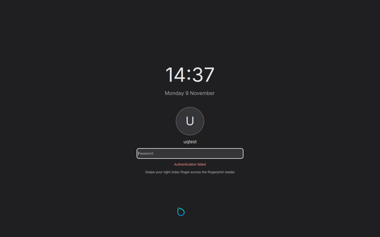
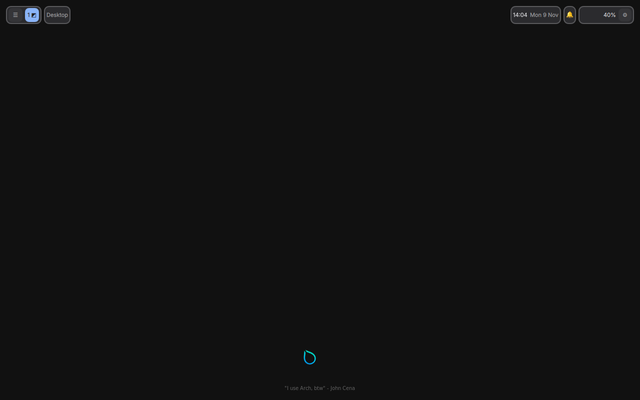

# Live checks in a VM: harness and results (2026-11-09)

The lock/idle/power checklist (`lock-idle-live-check.md`), the noti-fi checklist
(`notifi-hyprland-check.md`) and the slice 3 quick-settings checks were run in a QEMU/KVM Arch
guest, not on a desktop, by the harness in `tests/vm/`. This note describes the harness, how to
run it, and what it found. Nothing in uQ's shell, lock or bridge was changed.

**Final run:** `~/.cache/uq-vm/runs/20261109-141151/` (HEAD `5c069d2`, uq 0.2.0, uq-hyprland-pin
0.56.2, Hyprland 0.57.2 and Quickshell 0.3.2 from Arch, noti-fi 0.18.0 built from
`~/Projects/noti-fi` at `2a69151`). Q1, Q2 and Q5 were re-run on the same VM after fixing their
checks (see the table).

**Result: 26 PASS, 10 FAIL, 5 N/A** (41 checks). Two more checks, L6 and L7, passed in the final
run but failed in earlier runs; they're a load-dependent race, described under the failures.

| Area | FAILs |
|---|---|
| Idle | L9, L10, L11: a changed idle timing is not applied (Quickshell `IdleMonitor` ignores a new `timeout`) |
| Lock | L21: faillock's message is not shown; LJ: PAM messages reach the journal |
| noti-fi | N2, N4, N6: uQ never connects to noti-fi's socket; N1: `takeover --plain` doesn't start the service; N7: noti-fi's default theme hides uQ's tokens |
| Race | L6, L7 (intermittent): the machine can sleep before the lock is up when the lock takes more than 2 s to start |

## How to run

```bash
tests/vm/run.sh            # build HEAD, boot, run every check, print the table; exit 1 on any FAIL
tests/vm/run.sh --keep     # same, and leave the VM running afterwards
tests/vm/run.sh --only '^(L1|N2)$' --no-build    # some checks, reusing the last packages
tests/vm/run.sh --boot-only                      # boot and start the session only (implies --keep)
tests/vm/run.sh --refresh                        # rebuild the cached provisioned image
tests/vm/attach.sh eval 'run_checks "^L9$"; print_summary'   # re-run checks on a kept VM
tests/vm/attach.sh shot name                     # screenshot of a kept VM
tests/vm/attach.sh vm_quit                       # stop a kept VM
```

Needs `/dev/kvm`, `qemu-system-x86_64`, `qemu-img`, `xorriso`, `makepkg`, `cargo`, `python3`, `gpg`,
`jq` and ImageMagick (`magick`, for screenshot checks). Everything lives in `~/.cache/uq-vm`
(`UQVM_HOME`): `download/` (the cloud image), `images/` (the provisioned image), `pkg/`,
`notifi-target/`, and `runs/<timestamp>/` with each run's disk overlay, seed, ssh key, serial log,
screenshots, `evidence/<ID>.txt` and `results.tsv`. A full run takes about 35 minutes (the first
one adds about 4 minutes of provisioning). The VM gets 4 GB and 4 vCPUs (`UQVM_MEM`,
`UQVM_CPUS`). Without `--keep` the VM is stopped with QMP `quit` on every exit path.

## Harness design

- **Image** (`tests/vm/image.sh`): the newest `Arch-Linux-x86_64-cloudimg-*.qcow2` from
  geo.mirror.pkgbuild.com, checked against its `.SHA256` and its signature. The signing key is
  arch-boxes' CI key from the arch-boxes README, committed as `tests/vm/arch-boxes.asc` and pinned
  by fingerprint `1B9A16984A4E8CB448712D2AE0B78BF4326C6F8F` (the image is signed by its subkey
  `656E4C5A…859A9174`; the key is not in archlinux-keyring). A provisioned image (a 24 GB qcow2
  overlay of the cloud image) is built once with `pacman -Syu` plus Hyprland, Quickshell and the
  checks' packages (kitty, foot, pipewire/wireplumber, networkmanager, bluez, power-profiles-daemon,
  upower, brightnessctl, playerctl, fprintd/libfprint, hyprlock, libnotify, wtype, grim, jq, fonts,
  papirus, noto-fonts-emoji, mpv + mpv-mpris, xdg-desktop-portal-hyprland, wf-recorder, hostapd,
  iw). It is cached by a hash of the image name, the package list and `PROVISION_REV`. Each run
  boots its own qcow2 overlay of it.
- **cloud-init**: a NoCloud seed ISO (`xorriso`, label CIDATA) from `tests/vm/user-data.in` creates
  `uqtest` (wheel, passwordless sudo; password from `tests/vm/test-credentials`, a VM-only test
  value) with an ed25519 key generated per run in the run directory. A new instance-id per run
  makes cloud-init install that run's key.
- **Install** (`run.sh`): `scripts/build-local-pkg.sh` builds `uq-hyprland-pin` and `uq` from HEAD on
  the host (`-d --nocheck`, `TMPDIR`/`PKGDEST` under the cache). The packages go in over scp and
  are installed with `pacman -U`. Then `uqctl setup --json` runs as uqtest, the getty@tty1
  autologin drop-in and `~/.bash_profile` (`tests/vm/guest/`) are installed, and
  `ecosystem.no_update_news`/`no_donation_nag` are appended to the test user's `uq/user.lua` (the
  update dialog took focus from the checks). Restarting getty@tty1 logs uqtest in on tty1, which
  runs `start-hyprland`, so the session is a real logind session on seat0. The session is up when
  `hyprctl layers` shows `uq-bar`.
- **Machine**: `q35,accel=kvm,vmport=off -nodefaults`, S3 enabled (`ICH9-LPC.disable_s3=0`), virtio
  disk/net/keyboard/tablet, an HDA codec with a `none` audio backend (gives wireplumber a sink),
  `-display none`, a QMP socket. The serial console goes to `serial.log`. The GPU is
  `virtio-gpu-pci` when the host QEMU has it; this host's `qemu-base` doesn't
  (`qemu-hw-display-virtio-gpu` is not installed), so the runs used `bochs-display` (1280x800).
  Either way the guest renders with mesa llvmpipe, and QMP `screendump` captures the scanout,
  including the lock screen.
- **Driver** (`tests/vm/lib.sh`, `tests/vm/qmp.py`, stdlib only): `vg`, `vgsh` and `vroot` run
  commands over ssh (each argument quoted); `vgh` runs them through the guest's `uqvm-env`, which
  exports the session's `HYPRLAND_INSTANCE_SIGNATURE`, `WAYLAND_DISPLAY`, `XDG_RUNTIME_DIR` and
  `DBUS_SESSION_BUS_ADDRESS`. `hexec` runs a command from Hyprland (`hl.dsp.exec_cmd`), so it is in
  the graphical session (needed for polkit). `qmp` sends real input through the emulated devices:
  `key meta_l-l`, `type TEXT`, `click X Y`, `scroll`. Typing is slowed to about 6 keys/s, because
  faster input lost characters under llvmpipe load. It also covers `screendump`, `status`,
  `wakeup` and `quit`. On top of these sit `shot`, `layers`/`has_layer`, `locked_hint`,
  `wait_for`, `vm_suspend`/`vm_wakeup` and `vm_quit`. `checks/common.sh` adds the check framework
  (`check`, `note`, `bad`, `na`, `snap`, `ev`), `settle` (unlock, close surfaces, idle stages off,
  headless outputs removed after every check), `guest_prepare` and ImageMagick helpers.
  `find_template` locates a small PNG from `tests/vm/templates/` in a screenshot; the checks use it
  to find quick-settings rows, the lock screen, the countdown and the "Authentication failed"
  text.
- **Fingerprint**: fprintd runs with `FP_VIRTUAL_DEVICE=/run/fp-virtual.sock` (systemd drop-in), so
  libfprint's virtual_device driver is the reader. `guest/fp-virtual` enrolls `right-index-finger`
  by answering `fprintd-enroll` with `SCAN finger-1`, and presents fingers later
  (`SCAN finger-1`, `SCAN wrong-finger`).
- **Second monitor**: a Hyprland headless output (`hyprctl output create headless`); "unplugging"
  is `hyprctl output remove`. `hyprctl layers -j` gives each layer's monitor.
- **Wi-Fi**: `mac80211_hwsim radios=3`; hostapd serves `uq-open` (open) on wlan1 and `uq-secure`
  (WPA2) on wlan2, both unmanaged by NetworkManager; NetworkManager scans with wlan0.
- **noti-fi**: `notify` is built on the host (`cargo build --release -p notify-cli`, its own target
  dir in the cache) and copied to `~/.local/bin`. `guest/notifi-call` queries its control socket
  (`status`, `center`).

### VM-specific workarounds (in the harness, not in uQ)

- **Only the first S3 of a boot really sleeps** in this QEMU (11.1.2, q35/KVM). Later ones return
  from the firmware within milliseconds: no QMP SUSPEND event, and the kernel logs "Low-level resume
  complete" a few ms after entry. This happens with `-nodefaults`, without iTCO_wdt, and whether
  the wake came from QMP `system_wakeup`, a key or an RTC alarm. So each suspend check (L6, L7, L8)
  reboots the VM first when it has already slept.
- **The ICH9 TCO watchdog reset the guest** about 50 s after an S3 resume; `-global
  ICH9-LPC.noreboot=on` stops that.
- **The vmmouse (vmport) is a second absolute pointer** that fought the tablet; `vmport=off`.
- **Clicks need a hover first**: a press in the same instant as the motion, or with the pointer
  already on the spot, could miss a surface that had just mapped. `qmp click` approaches from 2 px
  away.
- **Keys pressed over the lock land in its password field** (SUPER+Space and SUPER+N in L3 typed
  " n"), so `unlock_pw` clears the field (ctrl+a, Backspace) first. It also waits until the lock
  surface is on screen, because it sometimes took 2 to 6 s to load (see L6/L7).
- **Idle timings**: L5, L15 and L16 set their timings and then lock and unlock once, so the idle
  monitors pick up the new timeouts (the L9 failure). Otherwise they would test nothing.

## Results (final run, `~/.cache/uq-vm/runs/20261109-141151/`)

Evidence for each row is in `evidence/<ID>.txt` and screenshots `<ID>-*.png` in that directory.

| ID | Check | Result | Evidence |
|---|---|---|---|
| L1 | Lock and unlock with a password | PASS | SUPER+L locked; the wrong password showed the red PAM message; the right one, typed straight after without clearing, unlocked (so the field was cleared); 3 s later `uq-lock` ActiveState=inactive Result=success ExecMainStatus=0, NRestarts unchanged. `L1-locked.png`, `L1-wrong-password.png` |
| L2 | Unlock with a fingerprint | PASS | Virtual reader. Wrong finger: "Failed to match fingerprint" relayed, still locked, polling went on; the enrolled finger unlocked. `L2-wrong-finger.png` |
| L3 | LockState from Hyprland | PASS | With spotlight and quick settings open: LockedHint=yes and both closed 605 ms after the key (timed in the guest, including 300 ms of lead). Locked: `qs ipc … open` spotlight/appmenu/quicksettings/powermenu all printed `ignored`; SUPER+Space and SUPER+N opened nothing; LockedHint=no after unlocking |
| L4 | `kill -9` the lock | PASS | The lock was back 203 ms after `pkill -9` (timed in the guest); the desktop never showed (`L4-after-kill.png`; an earlier run caught Hyprland's lock-died screen there); `L4-back.png` is the lock; LockedHint stayed yes |
| L5 | `kill -9` the shell | PASS | The shell restarted 1.8 s later; still locked (`L5-locked-after-shell-kill.png`); after unlocking the bar was back and dim 30 dimmed (after one lock/unlock, see L9) |
| L6 | Suspend from the power menu | PASS (intermittent FAIL) | Suspended 1.4 s after clicking Suspend; the last frame before sleep and the first on wake are the lock. The lock loaded 0.16 s after it started, before logind's sleep. FAILed in 1 of the 2 runs that reached the suspend, see below |
| L7 | Suspend from logind | PASS (intermittent FAIL) | uQ's "Lock the screen before sleep" delay inhibitor listed before and again after waking; the lock was up before sleep. FAILed in 2 of 3 runs, see below |
| L8 | Sleep fallback | PASS | With `uq-lock` masked: suspended 2.7 s after `systemctl suspend`; woke unlocked (the documented failure mode) |
| L9 | Dim | **FAIL** | `uqctl idle set dim 30`: no dim in 40 s. After one lock/unlock: dimmed at 30.7 s, the first key press removed it and reached the window under it (`x`), and a click removed it |
| L10 | Lock on idle | **FAIL** | `lock 40`: no lock in 55 s. After one lock/unlock: locked at 42.6 s |
| L11 | Screens off | **FAIL** | `screen-off 50`: still on after 65 s. After one lock/unlock: off at 50.2 s (dpmsStatus=false); a key press turned it back on |
| L12 | Screens off after locking | PASS | (a) SUPER+L: off 30.7 s after locking. (b) 20 s idle, then IPC lock (no input): off 31.1 s after locking, so it counts from the lock |
| L13 | Suspend on idle, on AC | PASS | UPower OnBattery=false; lock 40, suspend 60: locked, and not suspended 75 s after the last input |
| L13b | Suspend on battery | N/A | No battery device in QEMU |
| L14 | Suspend counts from last input | N/A | Needs battery power |
| L15 | Media playing | PASS | mpv + mpv-mpris playing (playerctl: Playing), dim 30, lock 40, screen-off 50 (after one lock/unlock): no dim, no screen-off, locked at 40.6 s. With `idle.media_blocks_lock` true (set via `SetSetting`): not locked after 55 s |
| L16 | Stay awake | PASS | Stay awake on; 60 s idle with dim 30, lock 40, screen-off 50 (after one lock/unlock): nothing happened |
| L17 | Restore the defaults | PASS | From dim 30, lock 40, screen-off 50, suspend 60, each command in the checklist's order succeeded; settings show 240/300/360/1200/30 |
| L18 | Power menu countdown | PASS | Countdown shown (`L18-countdown.png`). Esc, Cancel, a click outside and SUPER+L each aborted it; no restart 36 s after the last. Let run: the VM restarted (new boot id) and the session came back |
| L19 | App menu restart / shut down | PASS | Each opened the power menu at its countdown (`L19-restart.png`, `L19-shutdown.png`); Esc aborted; no restart or shutdown after 32 s |
| L20 | Polkit prompt | PASS | No other agent. `pkexec true` from the session: `uq-polkit` dialog (`L20-dialog.png`); wrong password: error, dialog stays (`L20-wrong-password.png`); right one: exit 0; Esc: exit 126; locked: dialog unmapped, back after unlocking, then authenticated |
| L21 | Faillock lockout | **FAIL** | After 3 wrong passwords faillock recorded 3 failures and the right password did not unlock (correct), and the fingerprint still unlocked (correct). But the lock showed "Authentication failed", not faillock's message (below) |
| L22 | `loginctl lock-session` | PASS | `loginctl lock-session 1` (the tty1 session; ssh is another session): locked 0.8 s later, uq-lock active |
| L23 | App menu Lock | PASS | App menu closed, locked |
| L24 | Recovery bind | PASS | `pkill -9` the lock, SUPER+CTRL+L at once: locked throughout, the lock back, the password unlocked, no hyprlock left running |
| LJ | Journal: no password or PAM message (checklist preamble) | **FAIL** | No password typed in the run appears in either journal. PAM messages do (below) |
| N1 | Takeover | **FAIL** | `notify takeover --plain`: installed, but notifd.service inactive; `busctl` names uq-shell.service as the owner (below) |
| N2 | Hello and subscribe | **FAIL** | After `systemctl --user restart uq-shell`, no connection from the shell to `notifd.sock` (checked with `ss -xp`); the island reads "Notifications handled by notify" (below) |
| N3 | Popups on the focused monitor | PASS | `"screen": "focused"` in rules.json, HEADLESS-1 focused: noti-fi reports popups on HEADLESS-1 and its layers are there |
| N4 | OSD on the focused monitor | **FAIL** | On each focused monitor the volume key showed uQ's own OSD (`uq-osd` on that monitor), never noti-fi's: follows from N2 |
| N5 | Unplugging a monitor | PASS | Popup and OSD on HEADLESS-3, output removed: notifd still active, popups/OSD and its layers moved to Virtual-1 |
| N6 | Centre from SUPER+N / island | **FAIL** | noti-fi's `center` stayed false after SUPER+N twice and after a left click on the island: follows from N2 |
| N7 | Theme tokens | **FAIL** | noti-fi's list kept its colours through `rosewood light` and `dracula dark` while uQ's bar re-themed (below) |
| N8 | Sharing hides summaries | N/A | See N/A reasons |
| N9 | Nothing above the lock | PASS | `loginctl lock-session`, `notify-send`, volume key: the popup area of the screenshot is flat lock background (standard deviation 0) |
| Q1 | Wi-Fi scans only while the panel is open | PASS (re-run) | `RequestScan` calls to NetworkManager on the system bus: 0 in 30 s closed, 8 in 30 s open, 0 in 30 s after closing. The final run's first version of this check counted NetworkManager's LastScan, which also changes on its own scans; it was replaced |
| Q2 | Open networks shown as Open | PASS (re-run) | `uq-open` listed without the lock icon and without "Set up in Settings" (which `uq-secure` has); one click connected it (`nmcli`: active on wlan0). The row shows no "Open" text, only the absence of the lock (`Q2-networks.png`) |
| Q3 | Bluetooth connect | N/A | See N/A reasons |
| Q4 | No scroll jitter | N/A | See N/A reasons |
| Q5 | Schedule toggle | PASS (re-run) | After `uqctl weather set Paris`: two clicks on the Schedule switch: `GetSchedule` off → `{"mode":"sun","lat":48.85,"lon":2.35}` → off; the theme switched to light and back. In the final run the check read `GetSettings`, which has no schedule; fixed |
| Q6 | SUPER tap (slice 2) | PASS | On Hyprland 0.57.2 (Arch has no 0.56.2): a tap opened the app menu, a second closed it, SUPER+Z did not open it |

## The failures

### L9, L10, L11: a changed idle timing is not applied

- **Expected:** `uqctl idle set dim 30` dims after 30 s (lock 40 s, screen-off 50 s).
- **Observed:** nothing within 40, 55 or 65 s. The same timings work after one lock/unlock: dim
  30.7 s, lock 42.6 s, off 50.2 s.
- **Cause:** Quickshell 0.3.2's `IdleMonitor` reads `timeout` only when it becomes enabled; a new
  `timeout` on an enabled monitor is ignored. A probe in the guest showed it:
  - a monitor created with `timeout: 300` and changed to 10 at runtime never went idle;
  - monitors that were enabled after their timeout was set went idle at 10 s.
- **In `shell/idle/Idle.qml`:** each monitor's `enabled` and `timeout` both depend on
  `Settings.values.idle`. When a setting changes, the monitor is already enabled, or it is
  re-enabled before its timeout updates, so it keeps the old one.
- **Locking re-arms them:** `on()` turns dim, lock and screen-off off while locked and back on after
  unlocking, so they pick up the current timeouts then. The locked-screen-off stage (L12) is enabled
  at each lock, which is why it passes.
- **Startup (inferred, not measured):** the monitors are enabled with the defaults (240/300/360)
  before uqd's settings arrive. Saved custom timings would then only apply after the first
  lock/unlock.
- **Evidence:** `evidence/L9.txt`, `L10.txt`, `L11.txt`; the probe is under "Investigation notes".

### L21: faillock's message is not shown

- **Expected:** the lock shows "The account is locked due to …" as plain text.
- **Observed:** "Authentication failed" (`L21-right-password-during-lockout.png`):

  

- **PAM sent the message:** the lock's journal has
  `Relaying pam message: "The account is locked due to 3 failed logins." echo: 1 error: 0` and then
  `"(10 minutes left to unlock)"`, both before the next `"Password: "` prompt.
- **So uQ drops it:** the lock doesn't keep PAM's info messages and shows only its generic failure.
- **The rest of the row passes:** pam_faillock records failures from the unprivileged lock
  (`faillock --user uqtest` lists 3 `uq-lock` entries), the lockout holds, and the fingerprint
  unlocks.

### LJ: PAM messages reach the journal

- **Expected (checklist preamble):** "no password or PAM message may ever appear" in
  `journalctl --user -u uq-shell -u uq-lock`.
- **No password leaked:** neither password typed during the run appears in the user or system
  journal.
- **PAM messages do appear.** In one boot of the final run:
  - 41× `quickshell.service.pam.subprocess: Waiting for parent confirmation...`
  - 21× `Starting pam session for user "uqtest" with config "uq-lock-fingerprint"`
  - `Relaying pam message: "Password: "`, `"Swipe your right index finger across the fingerprint reader"`,
    `"Failed to match fingerprint"`, `"The account is locked due to 3 failed logins."`
  - `… Authenticated successfully.`
- **Where they come from:** journald tags these `_TRANSPORT=stdout` with
  `SYSLOG_IDENTIFIER=uq-lock-run` and `_COMM=qs` (PIDs of the PAM subprocess).
- **Why the filter misses them:** `packaging/uq-lock-run` only filters qs's stderr
  (`2> >(grep -v 'quickshell\.service\.pam')`). Quickshell's PAM subprocess evidently writes these
  lines to stdout, which goes to the journal unfiltered.
- **Also in the journal, normal for any PAM client:** `pam_unix(uq-lock:auth): authentication failure`
  and `pam_faillock(uq-lock:auth): Consecutive login failures …`, logged by the modules through
  syslog from the lock's processes.
- **Minor:** after each unlock systemd logs `uq-lock.service: Unit process N (grep) remains running
  after unit stopped.` (the wrapper's grep, under `KillMode=process`).

### N2 (and N4, N6): uQ never connects to noti-fi

- **Expected:** within 5 s of a shell restart, the island shows noti-fi's count and quick settings its
  Do Not Disturb.
- **Observed, with noti-fi running:**
  - noti-fi answers on `$XDG_RUNTIME_DIR/notifd.sock` (`notifi-call status` works, hello
    `{"event":"hello","name":"notifd","protocol":1,…}`);
  - noti-fi owns `org.freedesktop.Notifications`;
  - the shell never connects: no `qs` socket to `notifd.sock` in `ss -xp`, even minutes later.
- **What the user sees:** the island reads "Notifications handled by notify", the backend falls to
  `builtin` (which yields), the volume key shows uQ's own OSD (N4), and SUPER+N and the island do
  nothing (N6).

  

- **Cause:** `shell/notif/Notifi.qml`'s `attemptConnect()` probes the socket with a `FileView`
  (`preload: false`, then `path = …; reload()`) and connects only from `onLoaded`/`onLoadFailed`.
  In Quickshell 0.3.2 that FileView emits neither, for the socket or for a missing file, so
  `connect()` and `scheduleRetry()` are never reached. A probe in the guest showed it:
  - a `preload: false` FileView with `path` then `reload()`: no signal at all;
  - the same FileView with a bound `path` and default preload: a missing file gives
    `loadFailed(2)`, the socket gives `loadFailed(4)` ("Not a file").

### N1: `notify takeover --plain` installs but doesn't start

- **Observed:** it prints `(no --now: nothing running changes; notifd takes over at next login)`;
  `notifd.service` stays inactive, and uQ's built-in server keeps the name.
- **With `--now` too:** `notify takeover --plain --now` on an installed takeover refuses ("already
  installed").
- **Starting it by hand:** `systemctl --user start notifd` queues for the name (`InQueue`) and the
  start job times out (Type=dbus) while uQ's built-in server holds it. The harness started it with
  `--no-block` to go on; after the shell restart in N2, notifd got the name.
- **Who owns it:** either the checklist's step is wrong for noti-fi 0.18 (it should log in again,
  or start the service and then restart the shell), or noti-fi should start it. Report to noti-fi
  and/or correct the step. I didn't change the checklist, because this is not specific to a VM.

### N7: noti-fi's colours don't follow uQ's theme

- **Expected:** within about 2 s of `uqctl theme set rosewood light` and `dracula dark`, noti-fi's
  popups and list change colour.
- **Observed:** uQ re-themed at once (the bar went light) and noti-fi's open list stayed the same.
  The mean colour of its area was 0.1708 before, after rosewood light and after dracula dark.

  

- **Cause:** uQ writes `~/.local/state/uq/theme/tokens.json` and noti-fi's `Tokens.qml` reads it
  ("auto"). But the `rules.json` that `notify takeover` writes has an explicit `theme`
  (`card`, `border`, `text`, `subtext`, `button`, `buttonHover`), and per `Tokens.qml` the rules'
  `theme` settings win over the tokens. So a stock install never shows uQ's colours. Report to
  noti-fi.

### L6, L7 (intermittent): the machine can sleep before the lock is up

- **Passed in the final run.** The lock loaded 0.16 to 0.2 s after logind's PrepareForSleep, well
  before sleep.
- **Failed in earlier runs** (L6 in 1 of the 2 runs that reached the suspend, L7 in 2 of 3), when
  the guest was busy (llvmpipe, about 20% CPU steal on the host):
  - The desktop was the last frame before sleep and the first on wake:

    

  - L6 in `runs/20261109-130800`: LockedHint was no after waking.
  - L7 in `runs/20261109-135759`, journal timeline:

    ```
    14:04:04.750 systemd-logind: The system will suspend now!
    14:04:04.822 systemd[574]: Started uQ lock screen (Quickshell).
    14:04:06.754 systemd[1]: Reached target Sleep.            <- 2 s: uQ's fallback released the inhibitor
    14:04:06.798 kernel: PM: suspend entry (deep)
    14:04:08.905 kernel: ACPI: PM: Waking up from system sleep state S3
    14:04:09.652 uq-lock-run: INFO: Configuration Loaded       <- the lock surface only now
    ```

- **Cause:** when starting the lock instance (a fresh `qs -p /usr/share/uq/lock`) takes longer than
  the 2 s fallback, the inhibitor is released first and the machine sleeps showing the desktop. In
  the VM the lock took 2.4 to 6.6 s to load under load.
- **On real hardware:** a GPU should usually beat 2 s, but a slow or busy machine can lose the race,
  and the checklist expects that "nothing of the desktop flashes".

## N/A reasons

- **L13b, L14:** suspend on idle is gated on UPower `OnBattery`, and QEMU has no battery device. The
  AC half ran as L13 and passed: no suspend on AC.
- **N8:** noti-fi didn't count a wlr-screencopy recorder (wf-recorder) as a screen share
  (`sharing` stayed false). A real share needs a browser and xdg-desktop-portal's picker, which the
  VM can't drive.
- **Q3:** the VM has no Bluetooth adapter (no virtual HCI in this QEMU).
- **Q4:** scroll jitter is a visual judgement on real hardware.
- **Not run:**
  - The checklists' multi-monitor steps on real outputs: the harness uses a headless output as the
    second monitor; it is a real `wl_output` to clients.
  - The 0.56.2-specific SUPER-tap note: Arch ships 0.57.2.

## Other observations (not checklist rows)

- **Missing emoji font:** uQ's glyphs (🔒 ⏾ 📶 ☕ and others in the power menu, quick settings and
  the bar) need an emoji font. Without one (the first boot, before `noto-fonts-emoji` was added)
  they render as boxes. No uq dependency or optdepend pulls one in.
- **Xwayland crash:** Xwayland crashed (SIGABRT, `coredumpctl`) after an S3 resume in one run. That
  is not uQ.
- **The Wi-Fi row has no "Open" text:** an open network is recognisable only by the missing lock
  icon (Q2). If "shown as Open" means a visible label, that part is missing.
- **Keys over the lock:** shortcuts pressed while locked (SUPER+Space, SUPER+N) are typed into the
  password field.

## Investigation notes

- **The IdleMonitor probe:** run as `qs -p /tmp/probe` in the session. Monitor A had `timeout: 300`,
  changed to 10 after 1 s; B and C had `enabled: false`, set to true after their timeout. Only B and
  C reported `idle=true` within 30 s.
- **The FileView probe:**
  - `FileView { preload: false }` with `path` set and `reload()` called in a Timer: no
    `loaded`/`loadFailed`;
  - `FileView { path: "/nonexistent" }`: `loadFailed 2`;
  - `FileView { path: "$XDG_RUNTIME_DIR/notifd.sock" }`: `loadFailed 4`, with the warning
    "Read of … failed: Not a file".
- **Checklist edits:** none. No step was wrong only because of the VM. L22's `loginctl lock-session`
  needs the graphical session's id when run over ssh, which the harness passes; that's how ssh
  works, not a checklist error.
